<picture></picture>

<picture></picture>

<picture></picture>
<picture></picture>

<picture></picture>

<a href="https://github.com/shirumesu/MelonBanG"></a><a href="https://github.com/shirumesu/melon_libtorrent"></a> 
<a href="https://github.com/shirumesu/ui_bot"></a><a href="https://github.com/shirumesu/Neopot"></a><a href="https://github.com/shirumesu/gei"></a> 
<a href="https://github.com/shirumesu/GPTize"></a><a href="https://github.com/shirumesu/respond-like-human"></a><a href="https://github.com/shirumesu/Anti-Anime-License"></a> 

<picture></picture>

  <picture>
    <source media="(prefers-color-scheme: dark)" srcset="https://git-stats.konataizumi.com/api?username=shirumesu&show_icons=true&border_radius=8&bg_color=0f1f26&title_color=6cc6dc&text_color=d9e9ee&icon_color=6cc6dc&ring_color=6cc6dc&border_color=22404a">
    
  </picture>
  <picture>
    <source media="(prefers-color-scheme: dark)" srcset="https://git-stats.konataizumi.com/api/top-langs/?username=shirumesu&layout=compact&hide=css&langs_count=8&card_width=455&border_radius=8&bg_color=0f1f26&title_color=6cc6dc&text_color=d9e9ee&icon_color=6cc6dc&ring_color=6cc6dc&border_color=22404a">
    
  </picture>

<picture>
  <source media="(prefers-color-scheme: dark)" srcset="https://github.pumbas.net/api/contributions/shirumesu?days=31&radius=8&colour=6cc6dc&bgColour=0f1f26&lineColour=6cc6dc&dotColour=f4d35e&areaColour=6cc6dc&area=true&hide_border=true">
  
</picture>

<picture></picture>
<a href="https://www.konataizumi.com/"></a>

<picture></picture>
<a href="https://www.buymeacoffee.com/shirumesu"></a>

<picture></picture>
