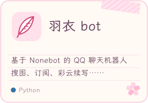
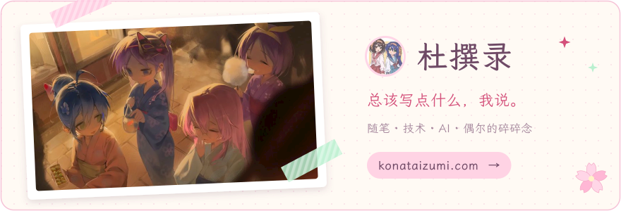
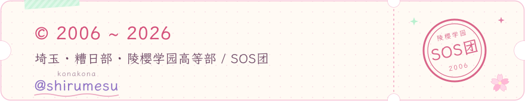

<picture></picture>

<picture>
  <source media="(prefers-color-scheme: dark)" srcset="resource/banner-dark.svg">
  
</picture>

📅 <i>Last updated:</i> <code>2026-11-01</code>

<picture></picture>

<picture></picture>

吾辈是希露梅斯，  
别看我这样子，其实我之前是个二次元.jpg  
虽然从来没有认可过自己的技术……但姑且就认为是技术宅吧！  
毕竟去异世界这种事说不定也会发生哦

总而言之，我在做一些有趣的事，让我觉得开心的事  
如果让你也觉得有趣就再好不过了。

> *The truth shall make you free. —— John 8:32*

 

<picture></picture>

  
  
  

<table>
  <tr>
    <td width="50%" valign="top">
      <b>🌀 AI 相关</b>
      <ul>
        <li><a href="https://github.com/shirumesu/gei">【芸】</a> 一套 Skill 涵盖所有使用场景</li>
      </ul>
      <b>📜 非原创</b>
      <ul>
        <li><a href="https://github.com/shirumesu/ShareTheSpire2">【ShareTheSpire2】</a> 杀戮尖塔 2 物品共享模组</li>
        <li><a href="https://github.com/shirumesu/Shop-Enhancement-STS2">【Shop-Enhancement-STS2】</a> 杀戮尖塔 2 商店体验增强模组</li>
      </ul>
    </td>
    <td width="50%" valign="top">
      <b>🌸 好玩 repo</b>
      <ul>
        <li><a href="https://github.com/shirumesu/GPTize">【GPTize】</a> 让文本变成 GPT 一样味大。"All you need is GPTize"</li>
        <li><a href="https://github.com/shirumesu/Anti-Anime-License">【反二次元许可证】</a> 二次元完蛋了喵！</li>
        <li><a href="https://github.com/shirumesu/respond-like-human">【Respond-like-human】</a> 让你的 GPT 说人话</li>
      </ul>
    </td>
  </tr>
</table>

<picture></picture>

<picture></picture>

  <picture>
    <source media="(prefers-color-scheme: dark)" srcset="https://git-stats.konataizumi.com/api?username=shirumesu&show_icons=true&border_radius=14&bg_color=1c1720&title_color=ff8fb6&text_color=f7e6f0&icon_color=ffb7d5&ring_color=ff8fb6&border_color=4a3445">
    
  </picture>
  <picture>
    <source media="(prefers-color-scheme: dark)" srcset="https://git-stats.konataizumi.com/api/top-langs/?username=shirumesu&layout=compact&hide=css&langs_count=8&card_width=455&border_radius=14&bg_color=1c1720&title_color=ff8fb6&text_color=f7e6f0&border_color=4a3445">
    
  </picture>

<picture>
  <source media="(prefers-color-scheme: dark)" srcset="https://github.pumbas.net/api/contributions/shirumesu?days=31&radius=14&colour=ff8fb6&bgColour=1c1720&lineColour=ff8fb6&dotColour=ffd3e4&areaColour=ff8fb6&area=true&hide_border=true">
  
</picture>

<picture></picture>

  
感谢你能喜欢我的作品？💝

  

 

<picture></picture>
